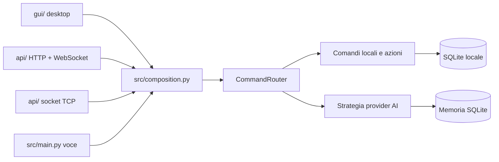

# Architettura e infrastruttura

## Tre contesti, un solo core

Il repository separa fisicamente le interfacce d'ingresso dal codice applicativo:



`gui/` gestisce rendering, navigazione, input e aggiornamenti desktop. `api/` traduce richieste HTTP, WebSocket e TCP in chiamate chat. `src/` contiene composizione, logica, provider, azioni, memoria e l'interfaccia vocale. I tre contesti condividono router, servizi e database tramite `src/composition.py`; non duplicano le regole di conversazione.

## Mappa dei moduli

| Percorso | Responsabilit\u00e0 |
|---|---|
| `gui/main.py` | Avvio desktop e impostazione dei percorsi d'importazione. |
| `gui/ui/app.py` | Finestra, navigazione, composizione condivisa e ciclo di vita delle viste. |
| `gui/ui/chat_view.py` | Conversazione, cronologia persistente, invio asincrono e controlli vocali. |
| `gui/ui/dashboard.py` | Dashboard e scorciatoie che inviano comandi al router. |
| `gui/ui/local_tools_view.py` | Routine, promemoria, preferenze e diagnostica. |
| `api/main.py` | Avvio da terminale dei listener locali e configurazione porte. |
| `api/bridge.py` | Adattatori HTTP, WebSocket e socket TCP JSON; validazione e serializzazione. |
| `src/composition.py` | Composition root e dependency injection comune a GUI, API e voce. |
| `src/core/command_router.py` | Router deterministico dei comandi e coordinamento delle azioni. |
| `src/core/local_features.py` | Regole e persistenza per attività, scadenze, routine e preferenze. |
| `src/core/prompt_budget.py` | Riduzione del contesto conversazionale senza dipendenze tokenizer. |
| `src/ai/llm_client.py` | Contesto conversazionale e accesso al provider AI scelto. |
| `src/ai/providers.py` | Strategia Ollama, LM Studio, provider automatico e diagnostica. |
| `src/actions/` | Integrazioni meteo, notizie, Gmail, sistema operativo e audio. |
| `src/interface/` | Acquisizione del parlato e sintesi vocale per l'interfaccia vocale. |
| `src/memory/` | Persistenza locale di conversazioni e fatti in SQLite. |
| `src/main.py` | Avvio dell'interfaccia vocale da terminale. |
| `tests/` | Test automatici offline con dipendenze simulate e database temporanei. |

## Flussi e casi d'uso

1. **Comandi noti e azioni locali**: il router riconosce prima meteo, volume, attività, routine, notizie, posta e azioni di sistema. Li esegue con servizi deterministici, senza consumare token AI inutilmente.
2. **Domande generali**: la richiesta non riconosciuta passa a `LLMClient`, che prepara un contesto limitato con cronologia e fatti utili.
3. **Selezione AI**: modalità automatica usa Ollama per richieste ordinarie e dati personali; per richieste complesse prova LM Studio locale se disponibile e ripiega su Ollama. I provider cloud sono espliciti e mai scelti automaticamente.
4. **Routine con effetti**: le routine ammettono solo azioni integrate e richiedono conferma esplicita prima di eseguire i passaggi.
5. **AI non disponibile**: la diagnostica espone lo stato dei provider; errori di connessione vengono restituiti come errore gestito, senza bloccare il thread grafico.
6. **Richieste concorrenti**: chat GUI, HTTP, WebSocket e TCP convergono sullo stesso router. `CommandRouter` serializza le transizioni conversazionali e `ChatGateway` protegge il confine d'accesso multi-thread.
7. **Input API errato o eccessivo**: l'adattatore rifiuta messaggi vuoti, payload non validi e richieste oltre i limiti prima di invocare il core.
8. **Memoria condivisa**: attività e preferenze usano lo store SQLite locale; la memoria conversazionale rende coerente la cronologia tra le interfacce che condividono il processo e il database.

Per l'API locale sono disponibili `GET /health`, `POST /api/chat`, `ws://127.0.0.1:8765/ws` e socket TCP JSON per riga su `127.0.0.1:8766`. I listener si legano a loopback. La GUI può avviare e arrestare il bridge durante il proprio ciclo di vita.

## Pattern applicati

- **Ports and adapters**: GUI, voce, HTTP, WebSocket e TCP sono adattatori sottili; la logica rimane nel core `src/`.
- **Composition root e dependency injection**: `create_application()` costruisce servizi e router una volta per processo, consentendo sostituti simulati nei test.
- **Command/router**: prima si risolvono localmente intenti noti, poi si delega al modello. Questo rende le azioni ripetibili e riduce latenza e token.
- **Strategy**: il client sceglie provider e modello in base a preferenza e complessità, mantenendo la modalità automatica locale.
- **Gateway**: l'API applica limiti, controlla concorrenza e converte gli errori in risposte di trasporto.
- **Repository/store locale**: le funzionalità strutturate usano SQLite invece di affidare task e preferenze alla memoria del modello.
- **Lazy initialization**: integrazioni facoltative, come OAuth Gmail, vengono inizializzate al primo utilizzo.
- **UI non bloccante**: le operazioni lente devono lavorare su thread worker e tornare al main loop Tk tramite coda/eventi.

## Persistenza, rete e privacy

- Database: `src/storage/jarvis.db` per cronologia, fatti, promemoria, routine e preferenze.
- Configurazione locale: `.env` per impostazioni facoltative; credenziali Gmail OAuth in `src/client_secret.json` e `src/token.json`.
- Ollama e LM Studio eseguono inferenza sul PC. Groq è un'opzione cloud scelta esplicitamente.
- Open-Meteo, feed RSS, Gmail, Google Speech Recognition ed Edge TTS richiedono rete quando usati.
- API HTTP e socket sono locali per impostazione predefinita. Non esporli direttamente su reti non fidate senza autenticazione e un livello TLS appropriato.
- Credenziali OAuth, token, `.env` e database personale sono esclusi da Git tramite `.gitignore`.

Promemoria, routine e preferenze non richiedono servizi a pagamento. Le funzionalità vocali online e i provider cloud dipendono dai servizi terzi e dai relativi termini/limiti.

## Verifica e avvio

Dalla radice del progetto:

```powershell
python -m unittest discover -s tests -t . -p "test_*.py" -v
python .\gui\main.py
python .\api\main.py
python .\src\main.py
```

Vedere [INSTALLAZIONE.md](INSTALLAZIONE.md) per dipendenze e [FUNZIONAMENTO.md](FUNZIONAMENTO.md) per i comandi utente.
