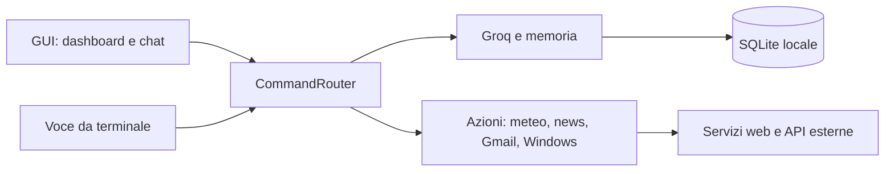

# J.A.R.V.I.S.

[Italiano](README.md) | [English](README_EN.md)

Assistente personale per Windows, realizzato in Python. J.A.R.V.I.S. combina una GUI desktop con una chat testuale e una dashboard animata, un'interfaccia vocale da terminale, servizi per meteo e notizie, comandi Windows e memoria locale.

> Il progetto è un prototipo personale ispirato all'interfaccia di Iron Man. Non è un prodotto ufficiale Marvel o Disney.

## Funzionalità

- Chat in italiano con Groq e modello `openai/gpt-oss-20b`.
- Memoria di conversazioni e fatti personali in SQLite.
- Interfaccia desktop CustomTkinter con dashboard HUD, chat persistente, dettatura vocale e lettura vocale facoltativa.
- Assistente vocale da terminale con riconoscimento Google Speech e sintesi Edge TTS.
- Meteo attuale e previsioni tramite Open-Meteo, con geolocalizzazione IP facoltativa.
- Riepilogo delle email Gmail non lette su richiesta, dalla chat o dalla voce.
- Titoli di notizie da feed RSS, apertura di programmi e siti, ricerca web e controllo del volume Windows.

La GUI **non include una sezione dedicata alla posta**. L'accesso alle email avviene tramite i comandi supportati da J.A.R.V.I.S.; la composizione di risposte non e' disponibile nell'interfaccia desktop.

## Avvio rapido su Windows

Prerequisiti: Python 3.10 o superiore, connessione Internet e una chiave API Groq. Microfono e uscita audio servono per le funzioni vocali.

Dalla cartella principale del repository, in PowerShell:

```powershell
py -3 -m venv .venv
.\.venv\Scripts\Activate.ps1
python -m pip install --upgrade pip
python -m pip install -r requirements.txt
Copy-Item .env.example .env
notepad .env
```

Imposta `GROQ_API_KEY` nel file `.env`, quindi avvia la GUI:

```powershell
python .\JarvisGUI\main.py
```

Per avviare l'assistente vocale da terminale:

```powershell
python .\src\main.py
```

La guida completa per le dipendenze, Groq, Gmail OAuth, avvio e problemi comuni e' in [INSTALLAZIONE.md](INSTALLAZIONE.md).

## Esempi di comandi

- `Che tempo fa domani a Milano?`
- `Dimmi le notizie`
- `Leggi le email non lette`
- `Che ore sono?`
- `Apri calcolatrice`
- `Cerca ricette vegetariane`
- `Alza il volume` oppure `Imposta il volume al 40`
- `Ricordati che il mio colore preferito è blu`
- `Cosa ti ricordi di me?`

La GUI apre sulla chat. `Ctrl+Invio` invia un messaggio; la dashboard contiene scorciatoie per le azioni principali. I comandi vocali e quelli inviati dalla GUI condividono il router e la cronologia.

## Configurazione Gmail facoltativa

Per il riepilogo delle email, abilita Gmail API in Google Cloud, crea credenziali OAuth di tipo applicazione desktop e salva il file scaricato in `src/client_secret.json`. Al primo comando email si apre il consenso Google nel browser; il token viene salvato in `src/token.json`.

Non inserire mai `.env`, `src/client_secret.json`, `src/token.json` o il database personale nel repository. Questi dati sono locali e sensibili. Per dettagli consulta [INSTALLAZIONE.md](INSTALLAZIONE.md) e [FUNZIONAMENTO.md](FUNZIONAMENTO.md).

## Architettura



La GUI e l'assistente vocale condividono i servizi in `src`. La memoria è locale; i servizi AI, meteo, notizie, riconoscimento vocale e Gmail richiedono Internet. La descrizione dei moduli e dei flussi è in [ARCHITETTURA.md](ARCHITETTURA.md).

## Struttura del repository

```text
Jarvis/
├── JarvisGUI/             # Entry point e interfaccia desktop
├── src/
│   ├── actions/           # Gmail, meteo, notizie, sistema e volume
│   ├── ai/                # Client Groq
│   ├── core/              # Router, testo e logica meteo
│   ├── interface/         # Microfono e sintesi vocale
│   ├── memory/            # Persistenza SQLite
│   └── main.py            # Entry point vocale
├── requirements.txt
├── INSTALLAZIONE.md
├── FUNZIONAMENTO.md
└── ARCHITETTURA.md
```

## Privacy e sicurezza

- Il testo delle richieste AI viene inviato a Groq.
- L'audio dettato viene inviato a Google Speech Recognition; la sintesi Edge TTS richiede rete.
- Le richieste meteo, notizie e Gmail contattano i rispettivi servizi esterni.
- La cronologia e i fatti vengono salvati localmente in `src/storage/jarvis.db`.
- `.env`, credenziali OAuth, token e database sono esclusi dal controllo versione tramite `.gitignore`. Controlla sempre i file staged prima di pubblicare modifiche su GitHub.

## Documentazione

- [Installazione e configurazione](INSTALLAZIONE.md)
- [Funzionamento e comandi](FUNZIONAMENTO.md)
- [Architettura e infrastruttura](ARCHITETTURA.md)
- [English README](README_EN.md)

## Test e limiti

Il progetto è pensato principalmente per Windows; il controllo del volume usa componenti specifici di Windows. `src/test_core.py` è un'interfaccia testuale interattiva. `src/test_ai.py` contatta Groq e non è un test offline.
