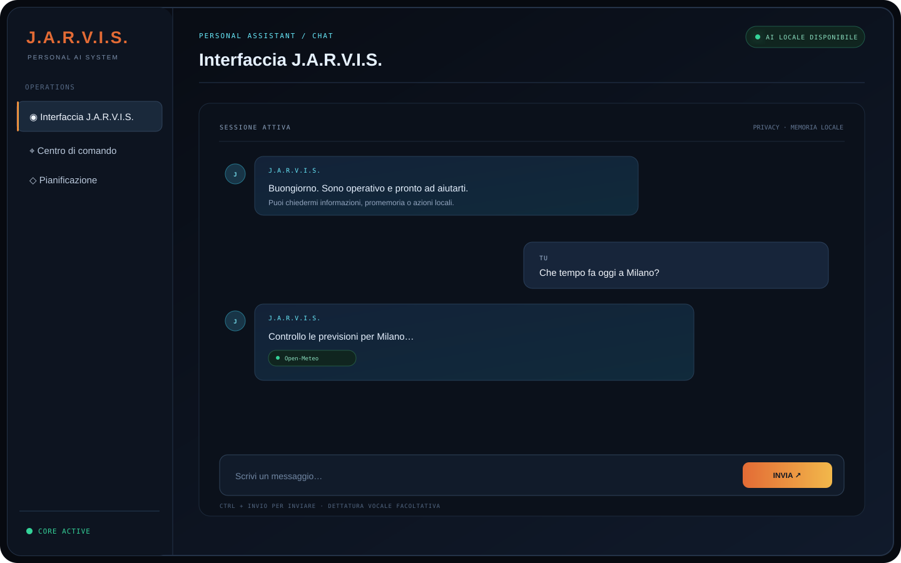
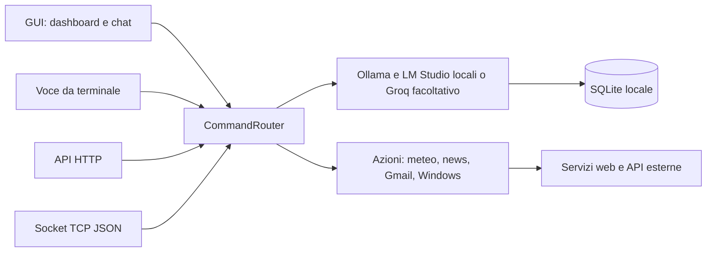

# J.A.R.V.I.S.

[Italiano](README.md) | [English](README_EN.md)

[](https://github.com/alexabdrustefu/Jarvis/actions/workflows/tests.yml)
[](https://github.com/alexabdrustefu/Jarvis/releases/latest)
[](LICENSE)

Assistente personale per Windows, realizzato in Python. J.A.R.V.I.S. combina una GUI desktop con una chat testuale e una dashboard animata, un'interfaccia vocale da terminale, servizi per meteo e notizie, comandi Windows e memoria locale.

> Il progetto è un prototipo personale ispirato all'interfaccia di Iron Man. Non è un prodotto ufficiale Marvel o Disney.



**Scarica per Windows:** [installer e archivio portatile nelle release](https://github.com/alexabdrustefu/Jarvis/releases/latest). La chat AI locale richiede [Ollama](https://ollama.com/download) e il modello `qwen3:4b`; il resto dell'app si avvia senza una chiave cloud.

Vuoi solo vedere l'interfaccia? Avvia `python .\gui\main.py --demo` per una [demo guidata offline](docs/DEMO.md), senza chiavi, account, microfono o chiamate di rete.

## Funzionalità

- Chat gratuita e locale con Ollama (`qwen3:4b`) oppure LM Studio; Groq è facoltativo.
- Scelta automatica del provider: richieste semplici e personali usano Ollama; quelle complesse provano LM Studio locale se attivo. La modalità automatica non invia messaggi ai servizi cloud.
- API HTTP e socket TCP locali per integrare un client web, senza framework o servizi a pagamento.
- Memoria di conversazioni e fatti personali in SQLite.
- Promemoria e attività locali con scadenze, notifiche desktop e comandi in italiano.
- Routine configurabili con azioni consentite e conferma prima dell'esecuzione.
- Preferenze locali per voce, velocità di lettura e città meteo; diagnostica per API key, microfono e rete.
- Interfaccia desktop CustomTkinter con dashboard HUD, chat persistente, dettatura vocale e lettura vocale facoltativa.
- Assistente vocale da terminale con riconoscimento Google Speech e sintesi Edge TTS.
- Meteo attuale e previsioni tramite Open-Meteo, con geolocalizzazione IP facoltativa.
- Riepilogo delle email Gmail non lette su richiesta, dalla chat o dalla voce.
- Titoli di notizie da feed RSS, apertura di programmi e siti, ricerca web e controllo del volume Windows.

La GUI **non include una sezione dedicata alla posta**. L'accesso alle email avviene tramite i comandi supportati da J.A.R.V.I.S.; la composizione di risposte non e' disponibile nell'interfaccia desktop.

## Avvio rapido su Windows

Prerequisiti: Python 3.10 o superiore. Per la chat gratuita installa Ollama da [ollama.com/download](https://ollama.com/download) e scarica il modello con `ollama pull qwen3:4b`. La chat locale non richiede chiavi, account o pagamenti. Le funzioni meteo, notizie e voce possono richiedere Internet; Groq è facoltativo e soggetto ai limiti del piano gratuito.

Dalla cartella principale del repository, in PowerShell:

```powershell
py -3 -m venv .venv
.\.venv\Scripts\Activate.ps1
python -m pip install --upgrade pip
python -m pip install -r requirements.txt
```

Avvia la GUI:

```powershell
python .\gui\main.py
```

Per installare senza configurare Python, scarica `JARVIS-Setup-*.exe` dalla [pagina Releases](https://github.com/alexabdrustefu/Jarvis/releases/latest). Preferenze, memoria e token Gmail dell'installer vengono salvati in `%LOCALAPPDATA%\JARVIS`, fuori dalla cartella del programma.

La selezione automatica usa Ollama per richieste normali e dati personali; per richieste complesse prova LM Studio locale, poi ripiega su Ollama. Dalla sezione **Pianificazione** puoi scegliere **Automatico**, **Ollama**, **LM Studio** o, solo se vuoi usare un servizio cloud, **Groq facoltativo**. Per Groq imposta `GROQ_API_KEY` nel file `.env`.

Per abilitare API HTTP e socket dalla GUI, apri **Pianificazione** e seleziona **Avvia bridge per web**. Da terminale:

```powershell
python .\api\main.py
```

L'avvio da terminale apre Swagger UI automaticamente su `http://127.0.0.1:8765/docs` (`--no-browser` per evitarlo); lo schema OpenAPI è su `/openapi.json`. La REST API versionata include `POST /api/v1/chat`, menu navigabile `GET /api/v1/menu`, statistiche aggregate `GET /api/v1/stats`, promemoria CRUD `/api/v1/reminders` e lista routine `GET /api/v1/routines`. Restano compatibili anche `POST /api/chat`, `GET /health`, WebSocket `ws://127.0.0.1:8765/ws` e socket TCP JSON per riga su `127.0.0.1:8766`. I listener sono locali al PC.

```javascript
const chat = new WebSocket("ws://127.0.0.1:8765/ws");
chat.onopen = () => chat.send(JSON.stringify({ message: "Ciao" }));
chat.onmessage = (event) => console.log(JSON.parse(event.data).reply);
```

Per avviare l'assistente vocale da terminale:

```powershell
python .\src\main.py
```

La guida completa per le dipendenze, Groq, Gmail OAuth, avvio e problemi comuni e' in [INSTALLAZIONE.md](INSTALLAZIONE.md).

## Esempi di comandi

- `Che tempo fa domani a Milano?`
- `Dimmi le notizie`
- `Leggi le email non lette`
- `Che ore sono?`
- `Apri calcolatrice`
- `Cerca ricette vegetariane`
- `Alza il volume` oppure `Imposta il volume al 40`
- `Ricordati che il mio colore preferito è blu`
- `Cosa ti ricordi di me?`
- `Ricordami di comprare il latte domani alle 9`, `mostra promemoria`, `completa 2`.
- Crea una routine dalla sezione **Pianificazione** e avviala dicendo `avvia modalità lavoro`; conferma con `sì`.

Promemoria, routine e preferenze usano SQLite e non richiedono account o dipendenze aggiuntive. Gli avvisi desktop vengono mostrati mentre la GUI è aperta; il terminale vocale legge le scadenze al successivo ciclo di ascolto. Le funzioni già esistenti che usano AI, meteo, riconoscimento vocale o sintesi online mantengono i propri requisiti di rete e configurazione.

La GUI apre sulla chat. `Ctrl+Invio` invia un messaggio; la dashboard contiene scorciatoie per le azioni principali. I comandi vocali e quelli inviati dalla GUI condividono il router e la cronologia.

## Configurazione Gmail facoltativa

Per il riepilogo delle email, abilita Gmail API in Google Cloud, crea credenziali OAuth di tipo applicazione desktop e salva il file scaricato in `src/client_secret.json`. Al primo comando email si apre il consenso Google nel browser; il token viene salvato in `src/token.json`.

Non inserire mai `.env`, `src/client_secret.json`, `src/token.json` o il database personale nel repository. Questi dati sono locali e sensibili. Per dettagli consulta [INSTALLAZIONE.md](INSTALLAZIONE.md) e [FUNZIONAMENTO.md](FUNZIONAMENTO.md).

## Architettura



GUI, voce, API HTTP/WebSocket e socket TCP condividono router, servizi e memoria tramite `src/composition.py`. Con Ollama le richieste AI restano sul PC; Groq e altri servizi online richiedono Internet. Dettagli in [ARCHITETTURA.md](ARCHITETTURA.md).

## Struttura del repository

```text
Jarvis/
├── gui/                   # GUI desktop: viste e interazione
├── api/                   # Adattatori HTTP, WebSocket e socket TCP
├── src/
│   ├── composition.py     # Composizione condivisa e dependency injection
│   ├── actions/           # Gmail, meteo, notizie, sistema e volume
│   ├── ai/                # Provider Ollama/LM Studio/Groq e memoria AI
│   ├── core/              # Router, testo e logica meteo
│   ├── interface/         # Microfono e sintesi vocale
│   ├── memory/            # Persistenza SQLite
│   └── main.py            # Entry point vocale
├── requirements.txt
├── INSTALLAZIONE.md
├── FUNZIONAMENTO.md
└── ARCHITETTURA.md
```

## Privacy e sicurezza

- Con Ollama messaggi, cronologia e fatti restano sul PC. Groq riceve solo il prompt di sistema e il messaggio corrente, senza cronologia o fatti salvati.
- L'audio dettato viene inviato a Google Speech Recognition; la sintesi Edge TTS richiede rete.
- Le richieste meteo, notizie e Gmail contattano i rispettivi servizi esterni.
- La cronologia e i fatti vengono salvati localmente in `src/storage/jarvis.db`.
- `.env`, credenziali OAuth, token e database sono esclusi dal controllo versione tramite `.gitignore`. Controlla sempre i file staged prima di pubblicare modifiche su GitHub.

## Documentazione

- [Installazione e configurazione](INSTALLAZIONE.md)
- [Funzionamento e comandi](FUNZIONAMENTO.md)
- [Architettura e infrastruttura](ARCHITETTURA.md)
- [English README](README_EN.md)
- [Changelog](CHANGELOG.md)
- [Demo guidata](docs/DEMO.md)
- [Roadmap](ROADMAP.md)
- [Contribuire](CONTRIBUTING.md)

## Licenza

Questo progetto è distribuito con licenza [MIT](LICENSE). L'ispirazione a Iron Man riguarda solo l'interfaccia: J.A.R.V.I.S. non è affiliato né approvato da Marvel o Disney.

## Test e limiti

Esegui la suite automatica dalla radice del repository:

```powershell
python -m unittest discover -s tests -t . -p "test_*.py" -v
```

I test automatici sono raccolti in `tests/`. `tests/test_ai.py` contatta Groq solo se eseguito direttamente; `tests/manual_memory_console.py` avvia la chat testuale interattiva.

I test automatici usano dipendenze simulate e database temporanei. `tests/test_ai.py` è un controllo manuale live che contatta Groq solo se lanciato direttamente.

Il progetto è pensato principalmente per Windows; il controllo del volume usa componenti specifici di Windows. `tests/manual_memory_console.py` è un'interfaccia testuale interattiva. `tests/test_ai.py` contatta Groq e non è un test offline.
