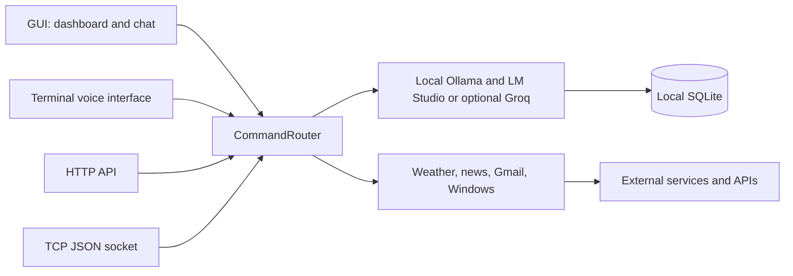

# J.A.R.V.I.S.

[Italiano](README.md) | [English](README_EN.md)

A personal Windows assistant built with Python. J.A.R.V.I.S. combines a desktop GUI with a text chat and animated dashboard, a terminal voice interface, weather and news services, Windows actions, and local memory.

> This is a personal prototype inspired by the Iron Man interface. It is not an official Marvel or Disney product.

## Features

- Free local Italian chat through Ollama (`qwen3:4b`) and LM Studio; Groq is optional.
- Automatic choice uses Ollama for ordinary or personal requests and local LM Studio for complex requests when running. Automatic mode never sends messages to a cloud provider.
- Local HTTP API and TCP socket for a future web client.
- Conversation history and personal facts stored in SQLite.
- Local reminders and tasks with due dates, desktop notifications, and Italian natural language commands.
- Custom routines with an allowlist of actions and an explicit confirmation before execution.
- Local voice, speech rate, and weather city preferences, plus diagnostics for API key, microphone, and network.
- CustomTkinter desktop app with an animated HUD dashboard, persistent chat, speech input, and optional text-to-speech.
- Terminal voice assistant using Google Speech Recognition and Edge TTS.
- Current weather and forecasts from Open-Meteo, with optional IP-based location lookup.
- On-demand unread Gmail summaries from chat or voice.
- RSS news summaries, Windows program and website launching, web search, and Windows master-volume controls.

The desktop GUI **does not have a dedicated Gmail screen**. Gmail summaries remain available through supported assistant commands; composing email replies is not available in the desktop UI.

## Quick start (Windows)

Requirements: Python 3.10 or newer. Install Ollama from [ollama.com/download](https://ollama.com/download) and run `ollama pull qwen3:4b` for free local AI. No API key or paid account is needed for local chat. Weather, news, and online voice features may need Internet access. Groq is optional and its free tier limits can change.

From the repository root in PowerShell:

```powershell
py -3 -m venv .venv
.\.venv\Scripts\Activate.ps1
python -m pip install --upgrade pip
python -m pip install -r requirements.txt
Copy-Item .env.example .env
notepad .env
```

Start the GUI:

```powershell
python .\gui\main.py
```

Choose **Automatic**, **Ollama**, **LM Studio**, or **Optional Groq** in Planning. To enable LM Studio, start its local server on port 1234 and load a model. Groq is used only when explicitly selected. The bridge can be started in Planning or with `python .\api\main.py`; the terminal command opens Swagger UI automatically (`--no-browser` disables it). Swagger UI is at `http://127.0.0.1:8765/docs` and the OpenAPI schema at `/openapi.json`. REST v1 includes chat, a discoverable feature menu, aggregate statistics, reminders, and routines; the legacy chat route, WebSocket, and newline-delimited TCP socket remain available. All listeners are loopback only.

Start the terminal voice assistant with:

```powershell
python .\src\main.py
```

See [INSTALLAZIONE.md](INSTALLAZIONE.md) for full setup, optional Gmail OAuth, and troubleshooting instructions.

## Optional Gmail setup

Enable Gmail API in Google Cloud, create OAuth credentials for a desktop application, and save the downloaded file as `src/client_secret.json`. The first Gmail command opens Google's consent flow in a browser. The token is stored in `src/token.json`.

Never commit `.env`, `src/client_secret.json`, `src/token.json`, or the personal SQLite database. See [FUNZIONAMENTO.md](FUNZIONAMENTO.md) and [ARCHITETTURA.md](ARCHITETTURA.md) for application behavior and internals.

Reminders, routines, and preferences use SQLite without extra accounts or dependencies. Desktop reminders appear while the GUI is open; the terminal voice assistant announces due items on its next listening cycle. Existing AI and online voice or weather features keep their current network and configuration requirements.

## Architecture



The GUI, voice assistant, HTTP/WebSocket API, and TCP socket share the router, services, and memory through `src/composition.py`. Memory is local; AI, weather, news, speech recognition, and Gmail features may use external services. See [ARCHITETTURA.md](ARCHITETTURA.md) for module responsibilities and data flows.

## Repository layout

```text
Jarvis/
├── gui/                   # Desktop UI adapter and views
├── api/                   # HTTP, WebSocket, and TCP adapters
├── src/
│   ├── composition.py     # Shared application composition root
│   ├── actions/           # Gmail, weather, news, system, and audio actions
│   ├── ai/                # Ollama/LM Studio/Groq providers
│   ├── core/              # Command routing and shared logic
│   ├── interface/         # Microphone and speech output
│   ├── memory/            # SQLite persistence
│   └── main.py            # Voice application entry point
├── requirements.txt
├── INSTALLAZIONE.md
├── FUNZIONAMENTO.md
└── ARCHITETTURA.md
```

## Privacy and security

- With Ollama, messages stay on the PC. Groq receives only the current message and system prompt, without saved facts or history.
- Dictated audio is sent to Google Speech Recognition; Edge TTS requires Internet access.
- Weather, news, and Gmail requests contact their respective external services.
- Chat history and personal facts are stored locally in `src/storage/jarvis.db`.
- `.gitignore` excludes environment variables, OAuth credentials, tokens, and the database. Review staged files before publishing to GitHub.

## Documentation

- [Installation and configuration](INSTALLAZIONE.md)
- [Features and commands](FUNZIONAMENTO.md)
- [Architecture and infrastructure](ARCHITETTURA.md)
- [README in italiano](README.md)

## License

This project is distributed under the [MIT License](LICENSE). The Iron Man reference is only an interface inspiration; J.A.R.V.I.S. is not affiliated with or endorsed by Marvel or Disney.

## Tests and limitations

Run the automated suite from the repository root:

```powershell
python -m unittest discover -s tests -t . -p "test_*.py" -v
```

Automated tests use fakes and temporary SQLite databases. `tests/test_ai.py` is a live smoke check that calls Groq only when run directly.

The project primarily targets Windows; master-volume control uses Windows-specific components. `tests/manual_memory_console.py` is an interactive text interface. `tests/test_ai.py` calls Groq and is not an offline test suite.
