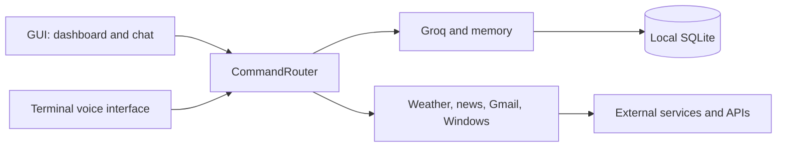

# J.A.R.V.I.S.

[Italiano](README.md) | [English](README_EN.md)

A personal Windows assistant built with Python. J.A.R.V.I.S. combines a desktop GUI with a text chat and animated dashboard, a terminal voice interface, weather and news services, Windows actions, and local memory.

> This is a personal prototype inspired by the Iron Man interface. It is not an official Marvel or Disney product.

## Features

- Italian conversations through Groq and `openai/gpt-oss-20b`.
- Conversation history and personal facts stored in SQLite.
- CustomTkinter desktop app with an animated HUD dashboard, persistent chat, speech input, and optional text-to-speech.
- Terminal voice assistant using Google Speech Recognition and Edge TTS.
- Current weather and forecasts from Open-Meteo, with optional IP-based location lookup.
- On-demand unread Gmail summaries from chat or voice.
- RSS news summaries, Windows program and website launching, web search, and Windows master-volume controls.

The desktop GUI **does not have a dedicated Gmail screen**. Gmail summaries remain available through supported assistant commands; composing email replies is not available in the desktop UI.

## Quick start (Windows)

Requirements: Python 3.10 or newer, Internet access, and a Groq API key. A microphone and audio output device are needed for voice features.

From the repository root in PowerShell:

```powershell
py -3 -m venv .venv
.\.venv\Scripts\Activate.ps1
python -m pip install --upgrade pip
python -m pip install -r requirements.txt
Copy-Item .env.example .env
notepad .env
```

Set `GROQ_API_KEY` in `.env`, then start the GUI:

```powershell
python .\JarvisGUI\main.py
```

Start the terminal voice assistant with:

```powershell
python .\src\main.py
```

See [INSTALLAZIONE.md](INSTALLAZIONE.md) for full setup, optional Gmail OAuth, and troubleshooting instructions.

## Optional Gmail setup

Enable Gmail API in Google Cloud, create OAuth credentials for a desktop application, and save the downloaded file as `src/client_secret.json`. The first Gmail command opens Google's consent flow in a browser. The token is stored in `src/token.json`.

Never commit `.env`, `src/client_secret.json`, `src/token.json`, or the personal SQLite database. See [FUNZIONAMENTO.md](FUNZIONAMENTO.md) and [ARCHITETTURA.md](ARCHITETTURA.md) for application behavior and internals.

## Architecture



The GUI and voice assistant share application services in `src`. Memory is local; AI, weather, news, speech recognition, and Gmail features use external services. See [ARCHITETTURA.md](ARCHITETTURA.md) for module responsibilities and data flows.

## Repository layout

```text
Jarvis/
├── JarvisGUI/             # Desktop application entry point and UI
├── src/
│   ├── actions/           # Gmail, weather, news, system, and audio actions
│   ├── ai/                # Groq client
│   ├── core/              # Command routing and shared logic
│   ├── interface/         # Microphone and speech output
│   ├── memory/            # SQLite persistence
│   └── main.py            # Voice application entry point
├── requirements.txt
├── INSTALLAZIONE.md
├── FUNZIONAMENTO.md
└── ARCHITETTURA.md
```

## Privacy and security

- Prompts sent to the AI are processed by Groq.
- Dictated audio is sent to Google Speech Recognition; Edge TTS requires Internet access.
- Weather, news, and Gmail requests contact their respective external services.
- Chat history and personal facts are stored locally in `src/storage/jarvis.db`.
- `.gitignore` excludes environment variables, OAuth credentials, tokens, and the database. Review staged files before publishing to GitHub.

## Documentation

- [Installation and configuration](INSTALLAZIONE.md)
- [Features and commands](FUNZIONAMENTO.md)
- [Architecture and infrastructure](ARCHITETTURA.md)
- [README in italiano](README.md)

## Tests and limitations

The project primarily targets Windows; master-volume control uses Windows-specific components. `src/test_core.py` is an interactive text interface. `src/test_ai.py` calls Groq and is not an offline test suite.
